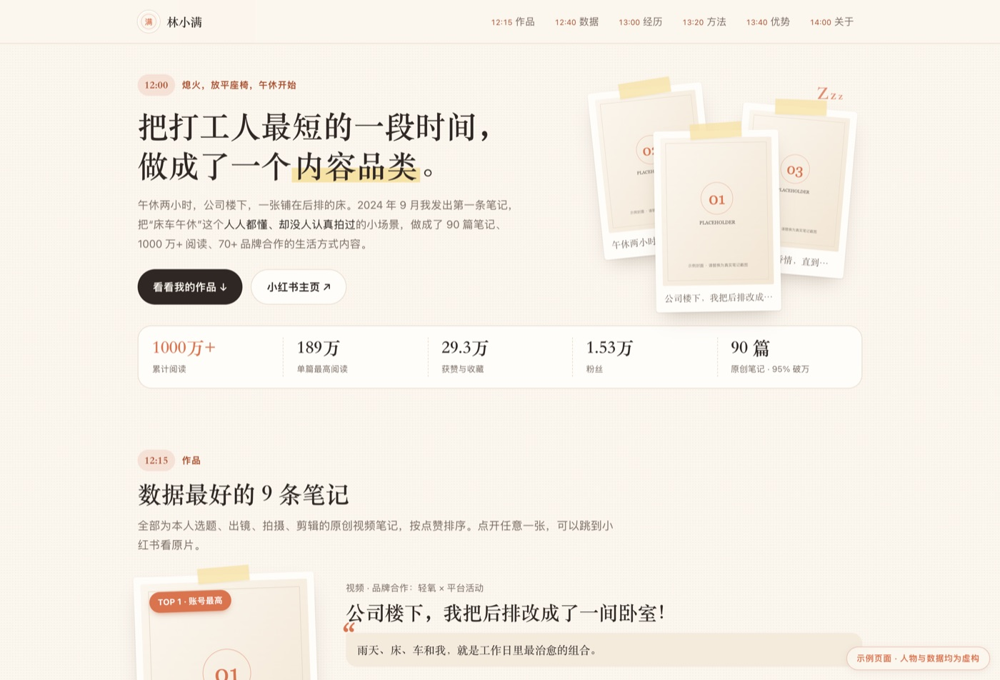

# blogger-portfolio · portfolio generator for content creators

[](LICENSE)
[](https://github.com/111seek/blogger-portfolio/releases)
[](scripts/build.py)
[](scripts/doctor.sh)
[](https://111seek.github.io/blogger-portfolio/)
[](#requirements)

[简体中文](README.md) ｜ **English**

[](https://111seek.github.io/blogger-portfolio/)

> Turn a creator's account data into a **single-file HTML portfolio** you can actually send to a recruiter:
> warm paper look, polaroid work wall, quarterly growth curve, scorecard + audience breakdown.
> One `index.html`, images inlined as base64, opens by double-click, no server, no CDN, no build step.
>
> **Self-serve only.** You must log in to your own Xiaohongshu account, and the logged-in account must
> **equal the account being profiled** — otherwise `check-self.sh` refuses and `build.py` won't build.
> It will not produce a portfolio for a third-party creator: that means handling someone else's notes,
> photos and commercial data without authorization.
> Want to hand it to another creator? Zip the folder and let them log in with their own account.
>
> **The core is platform-agnostic** — fill in `data.json` yourself and it works for TikTok, YouTube,
> Instagram, Bilibili, Xiaohongshu… The automatic scraping step currently only ships for Xiaohongshu.

It is also packaged as an **AI agent skill** (WorkBuddy / Claude Skill layout): the whole loop of
*fetch → pick a persona → write copy → build → verify* is captured in a template plus small scripts.
Switching to a different creator means switching `data.json`, not redesigning the page.

## Why this exists

Making a portfolio for a creator is not a CSS problem, it is three other problems:

1. **Where does the data come from** — likes, saves, publish dates need to be collected, de-duplicated and bucketed by quarter.
2. **What do you actually write** — interviews reward "this is the method I used and this is what it produced", not "I worked hard".
3. **How do you hand it over** — a portfolio that needs a running server is a portfolio nobody opens. It has to be a file.

This repo freezes all three. Output is a single HTML file with zero external requests.

## Quick start

```bash
# 0. Identity gate — required before any scraping (logged-in account must be the one you profile)
bash scripts/doctor.sh
bash scripts/check-self.sh --data my-portfolio/data.json

# 1. Build the bundled demo first — only python3 is required (fictional persona, gate skipped)
python3 scripts/build.py --data demo/data.json --out demo/index.html
open demo/index.html

# 2. Use your own data: copy the demo, edit fields, drop covers into its assets/
cp -r demo my-portfolio
bash scripts/check-self.sh --data my-portfolio/data.json   # writes .owner.lock + site.account
python3 scripts/build.py --data my-portfolio/data.json --out my-portfolio/index.html

# 3. Optional pre-flight check (needs playwright-core + local Chrome)
npm i playwright-core
node scripts/verify.js my-portfolio/index.html
```

`build.py` exits non-zero if any placeholder is still unfilled, so you never ship a half-rendered page.
After a successful build it lists the 7 sample copy blocks that still need to be rewritten for the real account.

## Preview loop

```bash
bash scripts/preview.sh                            # builds, serves, prints your LAN URL, rebuilds on save
bash scripts/preview.sh my-portfolio/data.json
bash scripts/preview.sh --port 9000 --no-watch
```

It builds into `.preview/` (gitignored), starts `python3 -m http.server` on `0.0.0.0`, prints both the
localhost and LAN address, and watches `data.json` / template / covers — edit, save, refresh on your phone.

Live version: <https://111seek.github.io/blogger-portfolio/>

## Scraping (optional, Xiaohongshu only)

Public data — note list, likes / saves / shares, covers, quarterly distribution — can be pulled with the
bundled CLI. **It is vendored under `vendor/redbook/`, no `npm i -g` needed.**

```bash
bash scripts/doctor.sh                   # checks node / CLI / cookie / login state
bash scripts/redbook.sh auth save        # authorize using the account already logged in Chrome
bash scripts/redbook.sh user-posts <userId> --all --delay 3000 --json > posts.json
```

Needs node ≥ 22 only. If you happen to have the global package installed, the launcher prefers it (so it
follows npm upgrades); otherwise it falls back to the vendored copy. Rules of the road: requests are serial
with a delay, and if a captcha appears, stop — you are risking the account otherwise.

Views, audience breakdown, brand count and GMV are not visible publicly — ask the creator for those.

See [`references/data-collection.md`](references/data-collection.md) for the full command set, aggregation
snippets, cookie repair via CDP, and the anti-bot notes.

## Page structure

Seven sections threaded on a "daily timeline" (labels are configurable, see `references/theming.md`):

| Section | Content | Rule |
|---|---|---|
| 12:00 Intro | Headline + lead + 5-slot data bar | One sentence must recap "what I made" |
| 12:15 Work | TOP1 broken out, TOP2–5 always visible, TOP6–9 collapsed | Covers must be the creator's own footage |
| 12:40 Data | Quarterly like curve + share/save ratio bars | Smooth curve, gradient area, drawn on scroll |
| 13:00 Story | Narrative + 2×2 scorecard + audience + summary | Numbers in three tiers: scale / breakout / commercial |
| 13:20 Method | 4 principles, each pinned to a number | Drop any principle without evidence |
| 13:40 Strengths | 4 capability cards (big number + tag + proof) | **Strengths, not a retrospective** — no problems, no next steps |
| 14:00 About | Closing line + fact table (city / school / handle / email) | So the interviewer can copy your contact |

## Repo layout

```
SKILL.md                      agent-facing skill doc (workflow + pitfalls)
scripts/build.py              data.json + template → single-file HTML
scripts/verify.js             pre-flight check at 1440 / 768 / 390
scripts/doctor.sh             scraper pre-flight (node / CLI / cookie / login)
scripts/redbook.sh            CLI launcher (global install → vendored copy)
scripts/preview.sh            build + serve + LAN URL + rebuild on save
assets/template.html          the page itself (full CSS/JS, {{PLACEHOLDER}} slots)
demo/                         runnable demo (fictional creator, placeholder covers)
docs/index.html               the GitHub Pages demo
references/                   scraping, copywriting formulas, theming
vendor/redbook/               bundled Xiaohongshu CLI (MIT, with dist/ and node_modules/)
```

## Pitfalls that actually bite

- **Contradictory numbers** — the creator says "80k likes", the profile shows 76k, the interviewer checks. Always use the displayed value.
- **Likes get capped** — above ~100k followers the platform shows "100k+" only, and save counts cap too. Any save÷like ratio is then just an upper bound; switch the ratio bars to absolute counts.
- **Ranking is fake once capped** — don't sort the top 9 by likes; pick one representative per content type and say why you didn't rank.
- **Writing a retrospective** — the words "problem", "next step", "what I learned" mean you drifted off. Replace the block with capability cards.
- **Mixed cover ratios** — one account can have 9:16, 3:4 and 4:3 covers at once. Crop everything to 3:4 with `object-position:50% 42%`.

## If this helped you

- ⭐ **A star** is the main reason this keeps getting maintained — and it helps other creators find it
- Built your own with it? Drop a link in [Discussions](https://github.com/111seek/blogger-portfolio/discussions)
- Want scraping for another platform (TikTok / Instagram / Bilibili)? Open an issue

## Requirements

- `python3` for the build (no third-party packages)
- `node ≥ 22` only for scraping and the optional pre-flight check
- `playwright-core` + local Chrome only for `verify.js`

## License

Repo code is MIT — see [LICENSE](LICENSE) (© 2026 seek-shao).
`vendor/redbook/` keeps its own MIT license from [lucasygu/redbook](https://github.com/lucasygu/redbook);
see [`vendor/NOTICE.md`](vendor/NOTICE.md). Both licenses must ship with any redistribution.
