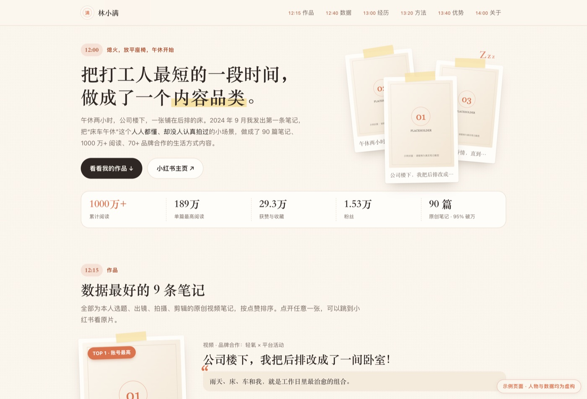

# blogger-portfolio · 博主作品集生成器

[](LICENSE)
[](scripts/build.py)
[](scripts/doctor.sh)
[](https://111seek.github.io/blogger-portfolio/)
[](#依赖与许可)

**简体中文** ｜ [English](README.en.md)

[](https://111seek.github.io/blogger-portfolio/)

> 给一个博主的账号数据，产出一份**面试能直接投的单文件 HTML 作品集**——浅色纸感、拍立得作品墙、季度曲线、成绩单 + 粉丝画像。
> 双击就能开，图片全部 base64 内嵌，发给面试官不用带任何附件。
>
> **只给本人用**：必须先用小红书登录，且**登录账号 == 要做的账号**，否则 `check-self.sh` 拒绝、
> `build.py` 也构建不了。不为第三方博主代做——抓的是别人的笔记、照片和商业数据。
> 想给别人用？把目录打包给他，让他用自己的号跑一遍。
>
> **核心与平台无关**：自己把数据填进 `data.json` 就能用（抖音 / B站 / Instagram / YouTube 都行）；
> 自动抓数目前只做了小红书。

同时它是一份 **AI Agent 技能**（WorkBuddy / Claude Skill 结构），把「取数 → 定人设 → 写文案 → 构建 → 体检」整套流程沉淀成了可复用的模板和脚本。换个人只需要换 `data.json`，不必重写设计。

```
docs/index.html   ← 在线 demo（GitHub Pages 部署的就是这一份，右下角带「示例页面」角标）
demo/             ← 生成 demo 的数据源（虚构人物，可照抄结构）
```

> 线上那份用 `python3 scripts/build.py --data demo/data.json --out docs/index.html --demo-banner` 生成，
> `--demo-banner` 会加一个「示例页面 · 人物与数据均为虚构」的角标，避免被当成真人主页。

## 它解决什么问题

给博主做作品集，难的不是排版，是三件事：

1. **数据从哪来**——主页上的点赞/收藏/发布时间要抓下来，还要去重、按季度聚合
2. **文案怎么写**——面试看的不是「我很努力」，而是「我用什么方法做出了什么结果」
3. **交付形态**——不能是一个要跑服务的网站，面试官点开链接就该看到东西

这个仓库把三件事都固化了。成品是单文件 HTML，无外链、无 CDN、无构建依赖。

## 快速开始

```bash
# 0. 先过身份闸（要抓数就必须做：登录账号必须就是要做的那个号）
bash scripts/doctor.sh                    # 看 node / CLI / cookie / 当前登录的是谁
bash scripts/check-self.sh --data my-portfolio/data.json

# 1. 先跑示例，确认环境没问题（只需要 python3，示例是虚构人物，跳过身份校验）
python3 scripts/build.py --data demo/data.json --out demo/index.html
open demo/index.html                    # 线上版本见 Pages：docs/index.html

# 2. 换成你的数据：复制 demo/data.json，改字段，封面图放进同目录 assets/
cp -r demo my-portfolio
bash scripts/check-self.sh --data my-portfolio/data.json   # 会写入 .owner.lock 和 site.account
python3 scripts/build.py --data my-portfolio/data.json --out my-portfolio/index.html

# 3. 交付前体检（可选，需要 playwright-core + 本机 Chrome）
npm i playwright-core
node scripts/verify.js my-portfolio/index.html
```

`build.py` 会先复核 `.owner.lock`（7 天有效），再检查占位符是否填完，任一不过就直接报错退出，不会产出半成品；构建完会列出还剩下的 7 处示例文案（模板自带的样例，必须按真实账号重写）。

## 本地预览

### 一条命令（推荐）

```bash
bash scripts/preview.sh                                  # 预览 demo/data.json
bash scripts/preview.sh my-portfolio/data.json           # 预览自己的数据
bash scripts/preview.sh --port 9000 --no-watch           # 换端口 / 关掉自动重建
bash scripts/preview.sh --demo-banner                    # 带「示例页面」角标，等同线上 demo
```

它做四件事：构建到 `.preview/index.html`（已 gitignore）→ 起 `python3 -m http.server` 绑 `0.0.0.0`
→ 打印本地和手机两个地址并自动开浏览器 → **盯着 `data.json`、模板和封面图，改了自动重建**。
所以循环是：改 `data.json` → 保存 → 手机下拉刷新，不用重启任何东西。`Ctrl+C` 退出。

```
数据源：demo/data.json
✓ 0 秒构建完成 · .preview/index.html  (52 KB，含 9 条笔记)

  本地：http://127.0.0.1:8080
  手机：http://192.168.1.23:8080   ← 同一 Wi-Fi 下打开
  改动 data.json / 模板 / 封面后自动重建，手机下拉刷新即可。Ctrl+C 退出。
```

### 手动几种方式

成品是**单文件、图片全部内嵌**，最省事的就是直接双击：

```bash
open demo/index.html            # macOS
# Windows: start demo\index.html    Linux: xdg-open demo/index.html
```

`file://` 能正常显示，没有外链请求，断网也一样。

<table><tr>
<td></td>
<td>手机端也单独调过：数据条折成两行、作品墙变单列、曲线图可横向滑动、正文不小于 14px。
面试官大概率是拿手机点开你发的链接——这一步值得自己先看一眼。</td>
</tr></table>

想确认**线上版本长什么样，就先在本地跑同一份**：

```bash
python3 scripts/build.py --data demo/data.json --out docs/index.html --demo-banner
cd docs && python3 -m http.server 8080    # 这就是 Pages 会发布的那一份
```

`ipconfig getifaddr en0` 可查本机内网 IP（Linux 用 `hostname -I`）。

> 注意：`--bind 0.0.0.0` 是让同网段的设备能访问，不要在有公共 Wi-Fi 的场合开太久。
> 只想本机看，去掉这个参数（默认只监听 127.0.0.1）。

## 抓数据（可选）

公开数据（笔记列表、点赞/收藏/分享、封面、季度分布）可以用内置的小红书 CLI 抓。**CLI 已经打包在 `vendor/redbook/` 里，不需要 `npm i -g`。**

```bash
bash scripts/doctor.sh          # 体检：node / CLI / cookie / 登录态
bash scripts/redbook.sh auth save        # 用本机 Chrome 已登录的小红书账号授权
bash scripts/redbook.sh user-posts <userId> --all --delay 3000 --json > posts.json
```

- 只装了 node ≥22 就能跑，内置副本会用自己的 `node_modules`，不污染全局环境
- 如果你自己 `npm i -g @lucasygu/redbook` 了，启动器会优先用全局版（能跟着 npm 升级）
- 阅读量、粉丝画像、品牌数、成交额这些主页看不到，**只能找博主本人要**

完整命令、去重与聚合脚本、Cookie 失效的 CDP 修复方案、评论抓取的反风控，见 [`references/data-collection.md`](references/data-collection.md)。

## 页面结构

七个板块用一条「生活时间线」串起来（编号可按人设替换，见 `references/theming.md`）：

| 板块 | 内容 | 关键要求 |
|---|---|---|
| 12:00 开场 | 标题 + 导语 + 5 格数据条 | 一句话能复述「我做出了什么」 |
| 12:15 作品 | TOP1 单列拆解 + TOP2–5 常显 + TOP6–9 折叠 | 封面必须是本人出镜的原片 |
| 12:40 数据 | 季度点赞曲线 + 分享率/收藏率比率条 | 曲线平滑、带渐变面积和描线动画 |
| 13:00 经历 | 叙事 + 2×2 成绩单 + 粉丝画像 + 总结 | 数字分三级：规模 / 爆发 / 商业化 |
| 13:20 方法 | 4 条原则，每条挂一个带数字的证据 | 没有数据支撑的原则不要写 |
| 13:40 优势 | 4 张能力卡（大数字 + 标签 + 证据） | **是优势不是复盘**，严禁写问题和计划 |
| 14:00 关于 | 收尾一句 + 事实表（坐标/院校/账号/邮箱） | 方便面试官抄联系方式 |

## 目录

```
SKILL.md                      Agent 技能说明（七板块流程 + 身份闸 + 常见坑）
scripts/check-self.sh         身份闸：登录账号 == 目标账号才放行，写 .owner.lock + site.account
scripts/build.py              data.json + 模板 → 单文件 HTML（构建前复核 .owner.lock）
scripts/verify.js             交付前体检（三档视口，查报错/溢出/对比度）
scripts/doctor.sh             取数前置体检
scripts/redbook.sh            CLI 启动器（全局版 → 内置副本）
scripts/preview.sh            构建 + 起服务 + 手机地址 + 改动自动重建
assets/template.html          页面模板（完整 CSS/JS，{{PLACEHOLDER}} 形式）
demo/                         可直接构建的示例（虚构人物 + 占位封面）
docs/index.html               GitHub Pages 在线 demo（由 demo/ 构建而来）
references/data-collection.md 抓数、聚合、Cookie 修复、反风控
references/copy-playbook.md   文案公式、三级数字、禁忌、面试问题映射
references/theming.md         换人设：时间线隐喻、色板、装饰、无障碍底线
vendor/redbook/               内置小红书 CLI（MIT，含 dist/ 与 node_modules/）
```

## 几个真会踩的坑

- **数字自相矛盾**：博主口述「8 万赞」、页面写 7.6 万，面试官一核对就崩。统一取主页显示值。
- **点赞会封顶**：粉丝过十万的账号，点赞一律显示「10 万+」，`collect_count` 也可能封顶。这时任何「收藏 ÷ 点赞」的比率都只是上限，不能当结论写——把比率条换成绝对值。
- **封顶之后排名是假的**：别按点赞排 TOP9，改成按内容类型各挑一条代表作，并在小标题里说明为什么不排名。
- **写成复盘**：出现「问题」「下一步」「学到」就是跑偏了，整块删掉换成能力卡。
- **封面比例混杂**：同一账号可能同时有 9:16、3:4、4:3 三种封面，统一 crop 到 3:4 + `object-position:50% 42%`。

## 如果这个仓库帮到你

- ⭐ **点个 Star** —— 这是我继续维护它的主要动力，也让更多做内容的人能搜到它
- 用它做出来了自己的作品集？去 [Discussions](https://github.com/111seek/blogger-portfolio/discussions) 贴个链接，我把它加进「谁在用」
- 想要别的平台自动取数（抖音 / B站 / Instagram / YouTube），开个 issue 说一声

## 依赖与许可

- 运行时：`python3`（构建）、`node ≥ 22`（仅抓数与体检需要）
- 体检：`playwright-core` + 本机 Chrome（可选）
- 内置的 [`vendor/redbook/`](vendor/NOTICE.md) 来自 [lucasygu/redbook](https://github.com/lucasygu/redbook)，MIT 许可，版权归原作者；升级与合规说明见 `vendor/NOTICE.md`
- 本仓库其余代码：MIT，见 [LICENSE](LICENSE)（Copyright © 2026 seek-shao）
